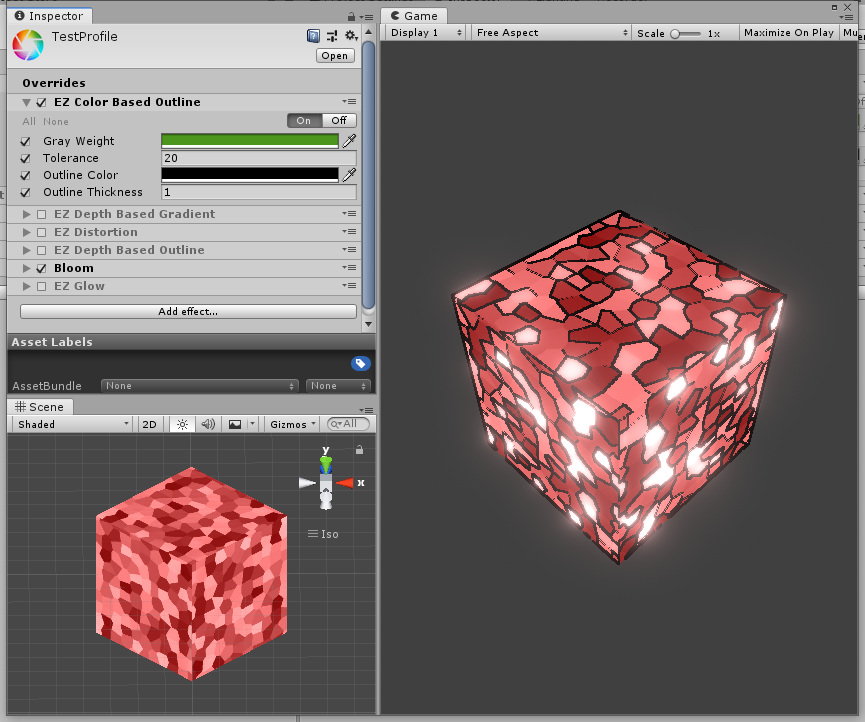
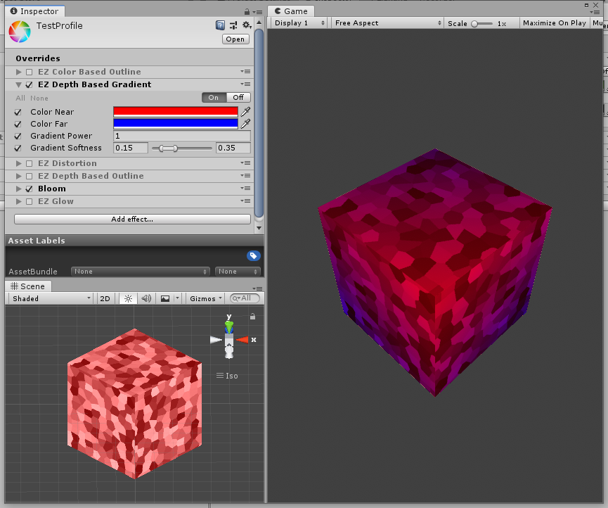
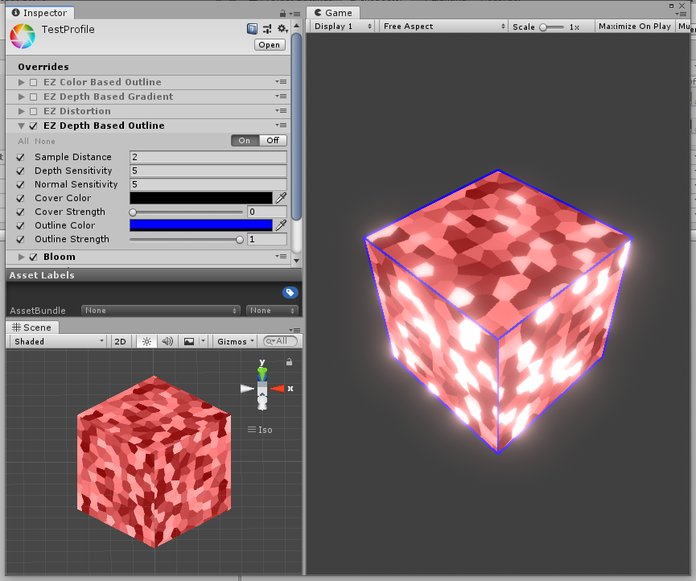
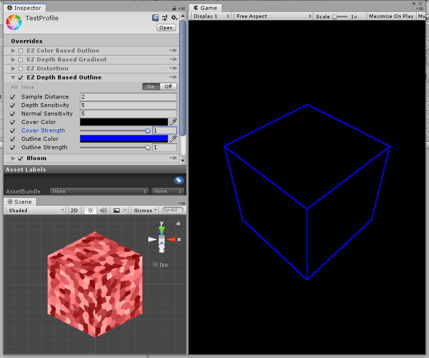
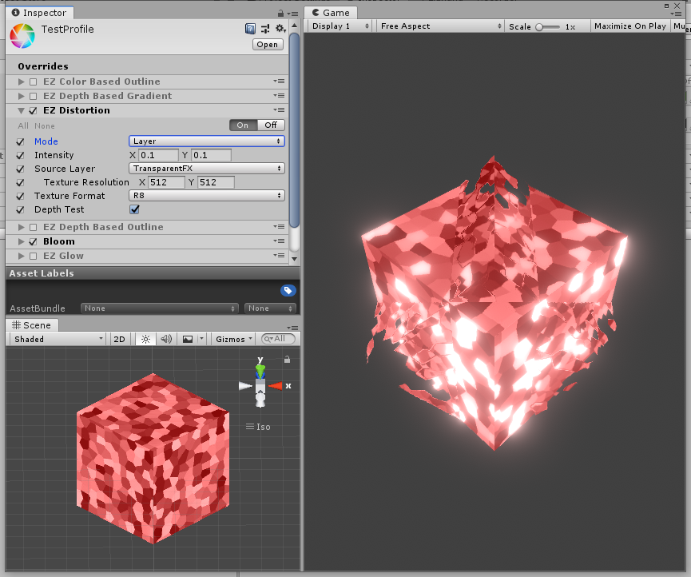
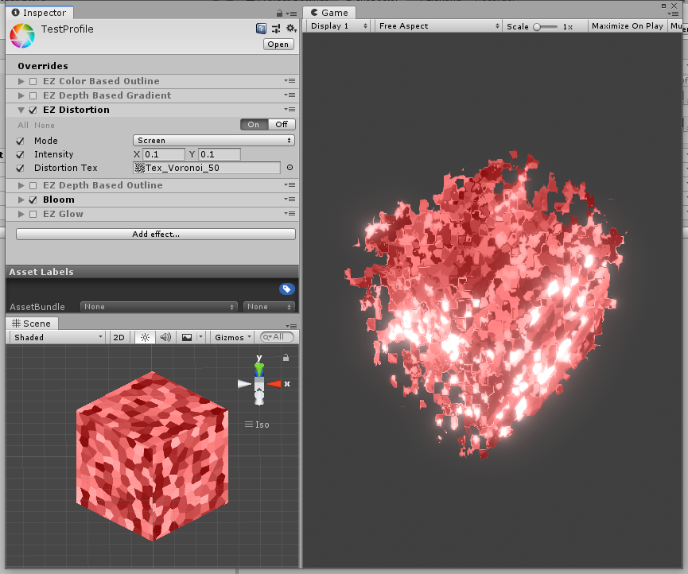
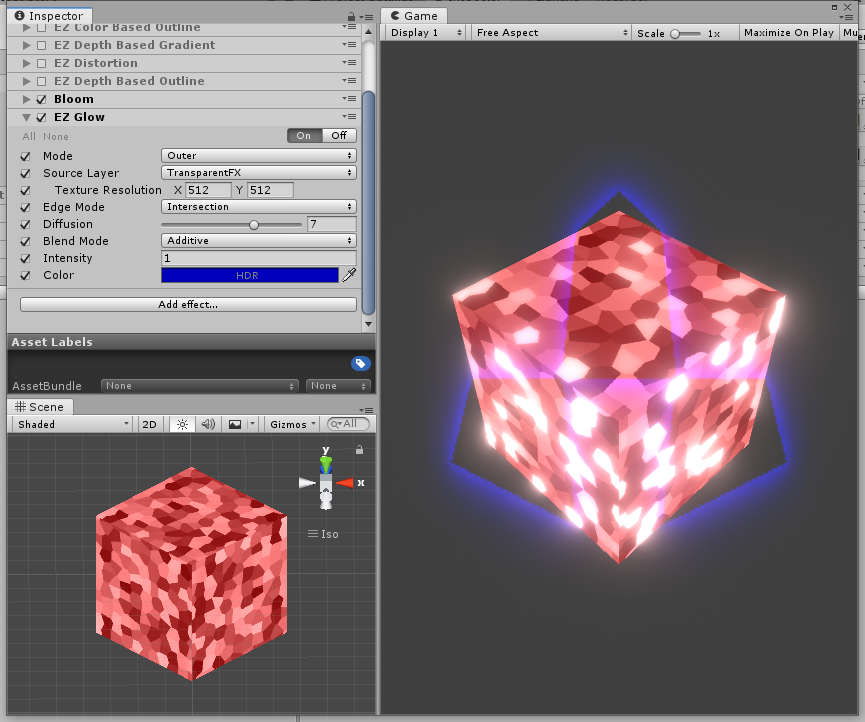

# EZPostProcessing

[English](README_EN.md)

EZPostProcessing 提供基于 Unity Post-Processing Stack 的自定义后处理效果。

最低支持 Unity 版本：`2020.3`。

## EZColorBasedOutline



## EZDepthBasedGradient



## EZDepthBasedOutline




## EZDistortion




## EZGlow




## 使用方式

安装 Unity 的 `com.unity.postprocessing` 包，然后在 Inspector 中将 EZPostProcessing 效果添加到 Post-process Volume。

示例场景和相关资产可以通过 **Window > Package Manager > EZPostProcessing > Samples** 导入。

## 目录结构

```text
EZPostProcessing/
├── Runtime/              运行时后处理效果和参数
├── Editor/               自定义 Inspector 和编辑器装饰器
├── Shaders/              效果使用的 Shader
├── Samples~/Demo/        示例场景、材质、纹理和 Profile
├── Documentation~/Images 文档中使用的功能图片
├── package.json          Unity Package Manager 包信息
├── README.md             中文说明
├── README_EN.md          English documentation
├── CHANGELOG.md          版本变更记录
└── LICENSE               MIT 许可证
```
