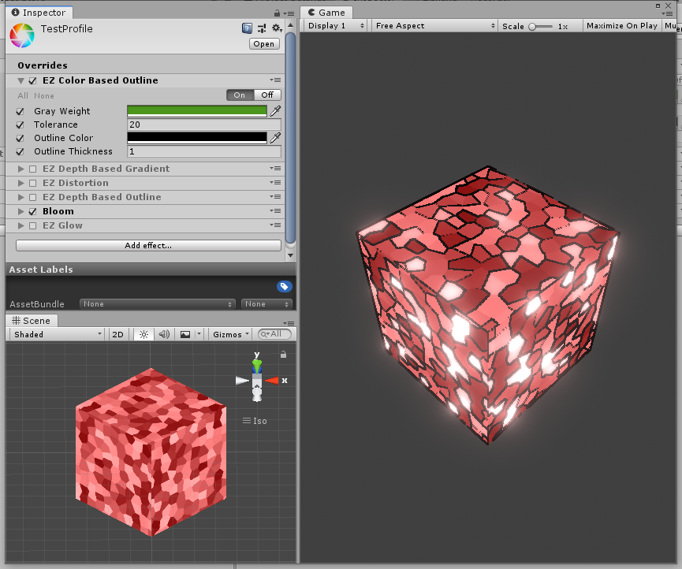
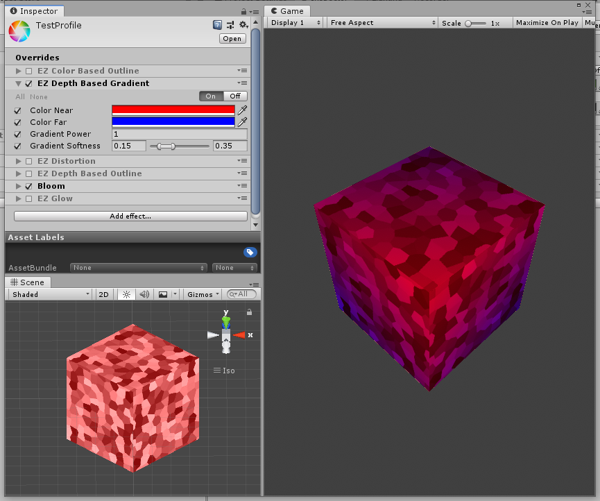
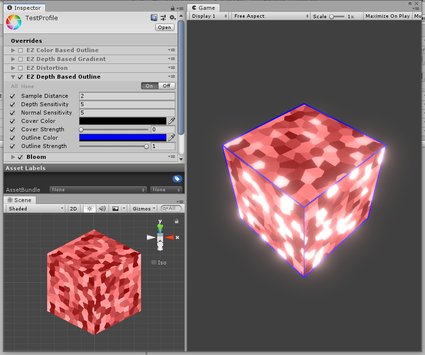
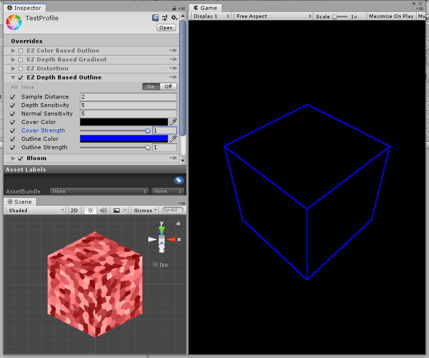
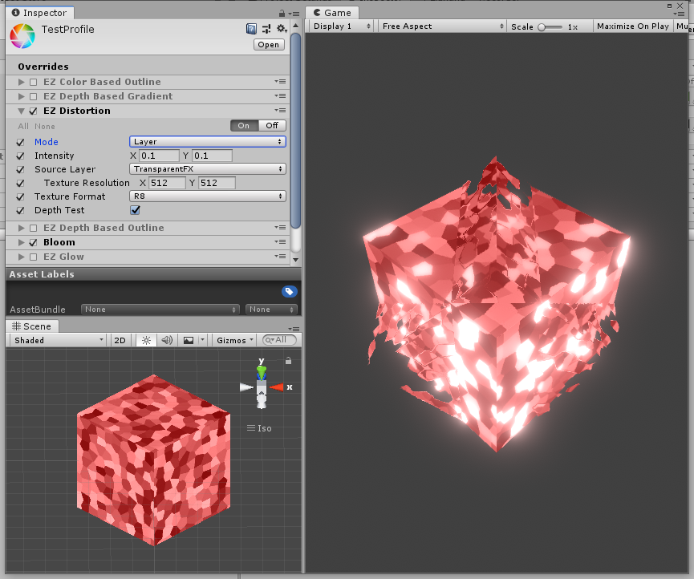
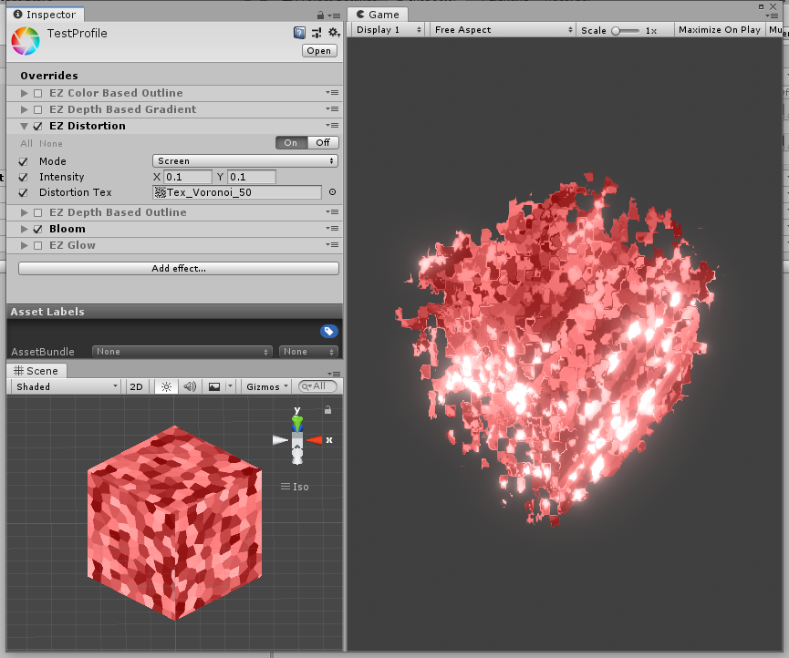
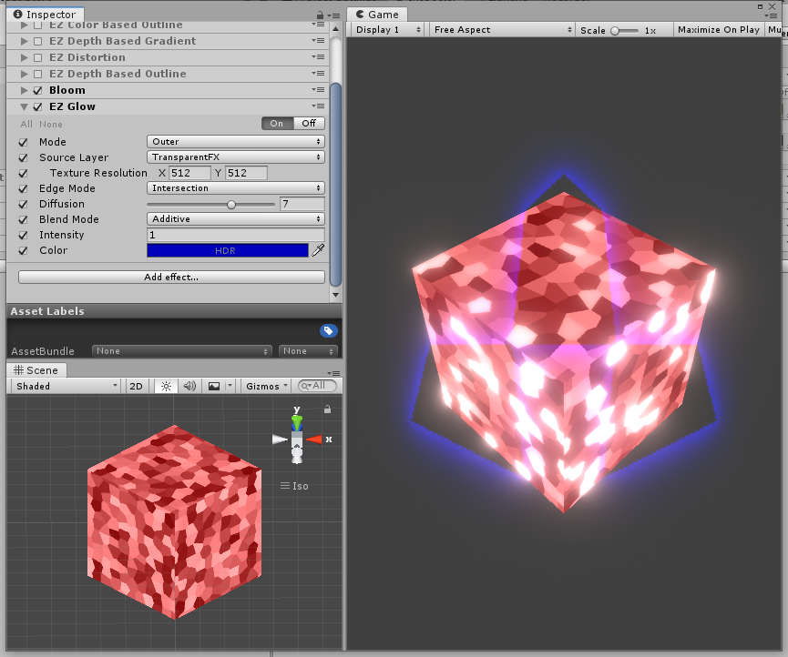

# EZPostProcessing

[中文](README.md)

EZPostProcessing provides custom post-processing effects for Unity's Post-Processing Stack.

Minimum supported Unity version: `2020.3`.

## Effects

### EZColorBasedOutline

Adds an outline based on color tolerance.



### EZDepthBasedGradient

Applies a gradient based on scene depth.



### EZDepthBasedOutline

Adds an outline based on scene depth.




### EZDistortion

Applies screen-space or layer-based distortion.




### EZGlow

Provides outer and inner glow effects.




## Usage

Install Unity's `com.unity.postprocessing` package, then add the EZPostProcessing effects to a Post-process Volume in the Inspector.

The demo scene and supporting assets can be imported from **Window > Package Manager > EZPostProcessing > Samples**.

## Directory structure

```text
EZPostProcessing/
├── Runtime/              Runtime post-processing effects and parameters
├── Editor/               Custom inspectors and editor decorators
├── Shaders/              Shaders used by the effects
├── Samples~/Demo/        Demo scene, materials, textures, and profiles
├── Documentation~/Images Documentation images
├── package.json          Unity Package Manager metadata
├── README.md             Chinese documentation
├── README_EN.md          English documentation
├── CHANGELOG.md          Release history
└── LICENSE               MIT license
```

## License

MIT License. See [LICENSE](LICENSE).
